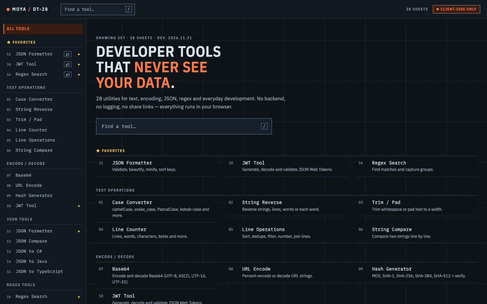
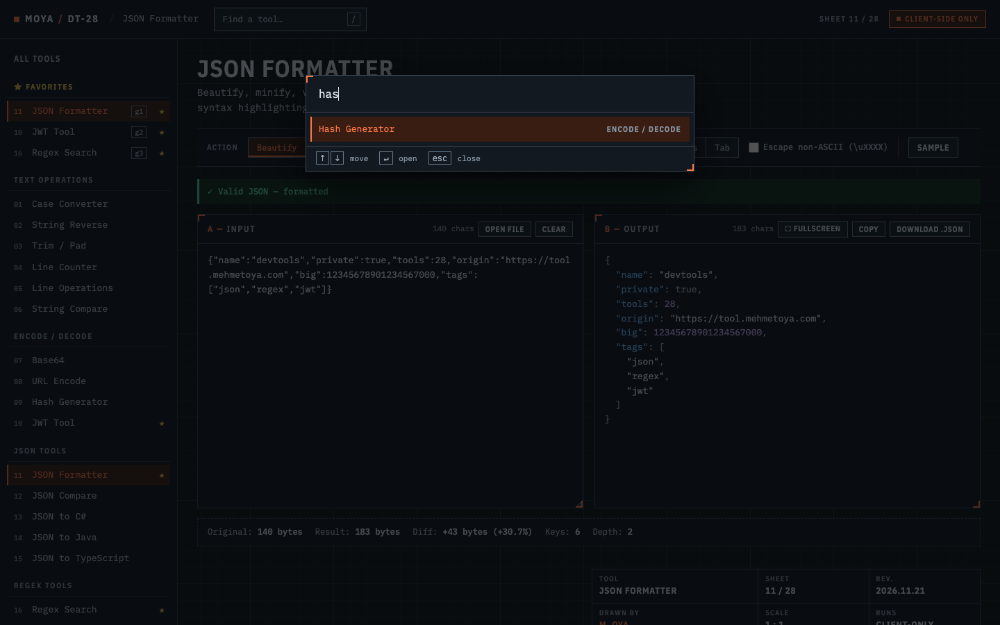
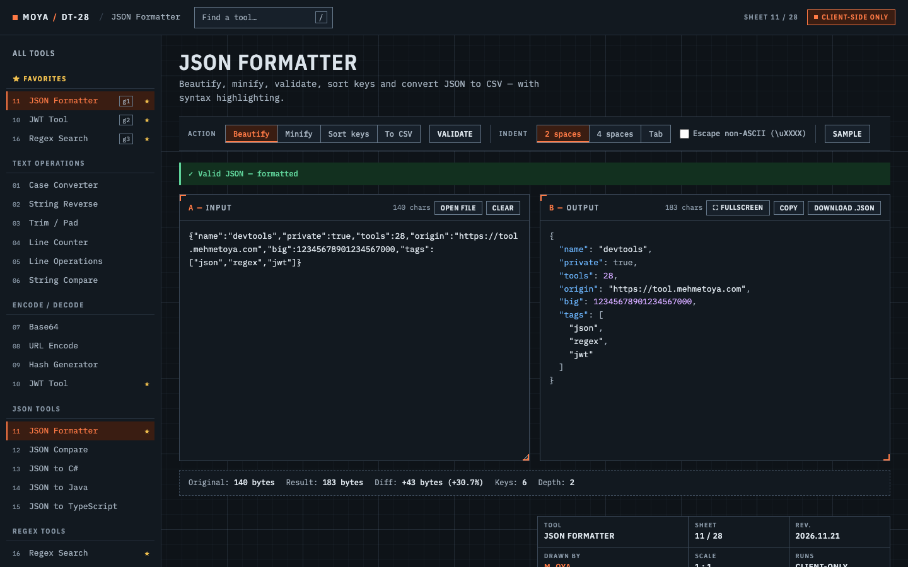
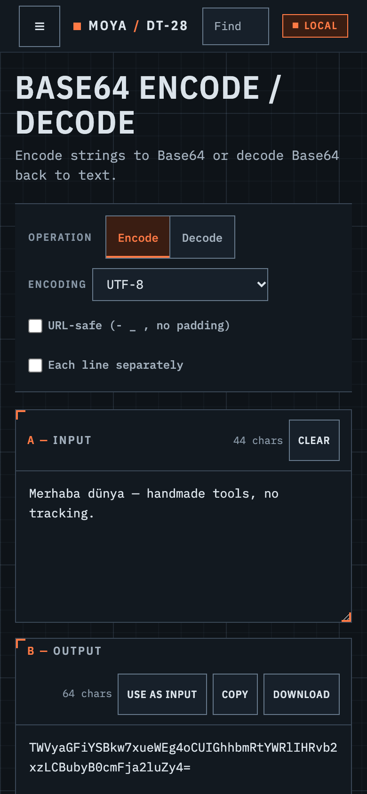

<div align="center">

# DevTools · DT‑28

**28 developer tools that never see your data.**<br>
JSON, Base64, hashes, JWT, regex, GUIDs, diagrams and more — running entirely in your browser, under a strict per-page Content-Security-Policy.

[**tool.mehmetoya.com**](https://tool.mehmetoya.com)

[](https://app.netlify.com/projects/devtool-moya/deploys)
[](LICENSE)




</div>

---

## Why

Most online formatters save what you paste to a public URL, log it server-side, or list it in an enumerable "recent" feed. In June 2026 researchers at BeyondMemory [documented](https://beyondmemory.io/blog/json-formatter-data-exposure) seven years of sensitive data — national IDs, IBANs, card numbers, API keys, production secrets — publicly readable on `jsonformatter.org`, plus a stored XSS in the formatter itself.

This project is the answer to that pattern: **the tool should never know what you pasted.** There is no server, no database, no analytics, no share links. Pages are static files; your input stays in the tab.

## Tools

| Category | Tools |
|---|---|
| **Text** | Case Converter · String Reverse · Trim / Pad · Line Counter · Line Operations · String Compare |
| **Encode / Decode** | Base64 · URL Encode · Hash Generator (MD5 / SHA / HMAC + verify) · JWT Tool |
| **JSON** | JSON Formatter (lossless big numbers) · JSON Compare · JSON → C# · JSON → Java · JSON → TypeScript |
| **Regex** | Regex Search · Regex Replace · String Extract — user patterns run in a worker with a timeout (ReDoS-safe) |
| **Developer** | DateTime Formatter · String Formatter (.NET-accurate) · GUID Generator · Password Generator · Number Converter · Barcode / QR · HTTP Client |
| **Viewers** | Markdown Viewer · HTML Viewer (sandboxed iframe) · Diagram Viewer (Mermaid) |

Every tool lives at `/<route>`; the registry (names, aliases, revisions) is in [`assets/tools.js`](assets/tools.js).

## Built for the keyboard

<table>
<tr>
<td width="50%"></td>
<td width="50%"></td>
</tr>
</table>

| Keys | Action |
|---|---|
| <kbd>/</kbd> or <kbd>⌘K</kbd> / <kbd>Ctrl+K</kbd> | Open the tool palette — prefix and substring match, accent-insensitive, with aliases (`b64`, `uuid`, `c#`, `md5`, `qr`, `curl`…) |
| <kbd>↑</kbd> <kbd>↓</kbd> <kbd>↵</kbd> <kbd>Esc</kbd> | Move, open, close |
| <kbd>g</kbd> then <kbd>1</kbd>–<kbd>9</kbd> | Jump to a favorite (★ any tool in the sidebar) |

Every tool is reachable in **≤ 4 characters** — the build gate proves it. Single-key shortcuts can be switched off in the sidebar (WCAG 2.1.4); <kbd>⌘K</kbd> always works.

## Privacy & security model

- **No backend, no storage of input.** Only favorites, the shortcut preference and the last draft of the Markdown / HTML / Diagram viewers are kept, in your browser's `localStorage`.
- **Hash-based CSP on every page** — `script-src 'self' 'sha256-…'`, no `'unsafe-inline'` (except the sandboxed HTML viewer, which must run your own scripts), `connect-src 'none'` everywhere except `/http-client`, `frame-ancestors 'none'`. The same policy ships as a header and as a `<meta>` tag.
- **No dynamic HTML from user data.** Tools write with `textContent` / `.value`. The only three HTML sinks — DOMPurify-sanitized Markdown, Mermaid's strict SVG, the sandboxed HTML preview — are pinned by exact line in the build gate.
- **Zero third-party requests.** Fonts (IBM Plex) and libraries (mermaid, DOMPurify, marked, qrcode) are self-hosted and sha256-pinned in `VERSIONS.txt`.
- **Only the site is published.** Netlify serves `dist/`, built from an allow-list, so repository files can't leak through case-variant URLs.

<details>
<summary><b>Full policy and headers</b></summary>

```
default-src 'self';
script-src 'self' 'sha256-…';   ← only this page's own inline scripts
style-src 'self' 'unsafe-inline';
font-src 'self';
img-src 'self' data:;
connect-src 'none';             ← /http-client: http: https:
object-src 'none';
base-uri 'self';
form-action 'self';
frame-ancestors 'none';

X-Frame-Options: DENY
X-Content-Type-Options: nosniff
Referrer-Policy: strict-origin-when-cross-origin
Permissions-Policy: geolocation=(), microphone=(), camera=(), payment=(), usb=(), interest-cohort=()
Strict-Transport-Security: max-age=31536000; includeSubDomains; preload
```

CSP is set per path in `_headers` (Netlify merges overlapping rules, which would make relaxing one page impossible).

</details>

## Design

A "technical drawing" system: charcoal paper with a measuring grid, one red-pencil accent, panels lettered like drawing views (A, B, C…), and a title block on every tool — *Tool · Sheet 07 / 28 · Rev. · Drawn by M. Oya*. Contrast of every text token is checked at build time (≥ 4.5 : 1), focus is always visible, and the grid turns off under `prefers-contrast` and forced colors.

<div align="center"></div>

## Development

No bundler, no `npm install` — Node 22+ and Chrome are all you need.

```bash
node scripts/serve.mjs . 8888                  # local server: _headers CSP, rewrites, hidden paths (127.0.0.1 only)
node scripts/check.mjs                         # build gate — also the first half of the Netlify build
node scripts/scan.mjs http://127.0.0.1:8888    # every page at 375 / 1280 px in real Chrome

# exactly what Netlify publishes:
node scripts/build-dist.mjs && node scripts/serve.mjs dist 8889
```

`scan.mjs` drives Chrome over the DevTools Protocol and fails on any CSP violation, console error, third-party request, horizontal overflow, or palette / drawer regression.

**Generated files — edit the generators, not the output:**

```bash
node scripts/json-codegen/build-gen-pages.js   # json-to-csharp / java / typescript pages
node scripts/gen-site.mjs .                    # home, 404, _headers, netlify.toml, sitemap, robots, page <head>s + CSP hashes
node scripts/build-dist.mjs                    # dist/ = exactly what Netlify publishes
node scripts/smoke.mjs https://tool.mehmetoya.com   # post-deploy smoke test (or a deploy-preview URL)
```

Any edit to a page's inline `<script>` changes its CSP hash — run `gen-site` afterwards (the gate fails otherwise).

<details>
<summary><b>What the build gate checks</b></summary>

- registry ↔ folders ↔ home ↔ `_headers` ↔ sitemap; generators produce no drift
- every page: title, description, canonical, one `h1`, meta CSP; inline script hashes present in `script-src`
- CSP invariants per route; HTML sinks allow-listed by exact line; no inline handlers; storage access inside `try`
- design-token contrast; every `@font-face` file exists and matches its sha256; vendor sha256
- palette: every tool first for some query of ≤ 4 characters; `rev` is `YYYY.MM.DD`
- deployment: publish folder is `dist/`, repo paths never in the allow-list, old-origin redirect ordered first

</details>

<details>
<summary><b>Project structure</b></summary>

```
/
├── index.html, 404.html     ← generated
├── <route>/index.html        ← one folder per tool
├── assets/
│   ├── app.css               ← design tokens and components
│   ├── tools.js              ← registry, header, sidebar, palette, favorites, title block, helpers
│   ├── regex-worker.js       ← user regexes off the main thread, with a timeout
│   ├── fonts/                ← IBM Plex (OFL) + VERSIONS.txt
│   └── vendor/               ← pinned libraries + VERSIONS.txt
├── scripts/                  ← site.mjs, gen-site, check, build-dist, serve, scan, smoke, json-codegen/
├── docs/                     ← specs, plans, task lists (never published)
├── _headers, netlify.toml    ← generated
└── .github/assets/           ← README images
```

**Adding a tool:** add it to `CATEGORIES` in `assets/tools.js` (with `aliases` and a `rev`), create `<route>/index.html` from an existing tool, then run `gen-site` and `check`. `build-dist` publishes every registered route automatically.

</details>

## Deployment

Netlify builds every push: `node scripts/check.mjs && node scripts/build-dist.mjs`, publishing `dist/`. A failing gate stops the deploy and the previous version stays live. Pull requests get a deploy preview; run `smoke.mjs` against it before merging. `devtool-moya.netlify.app` redirects permanently to `tool.mehmetoya.com`.

## SEO

Semantic HTML, per-tool titles and descriptions, Open Graph / Twitter cards, `WebApplication` + `BreadcrumbList` JSON-LD, and a readable "About this tool" section on every page.

## License

[MIT](LICENSE) © 2026 Mehmet Oya — free to use, fork and adapt.
